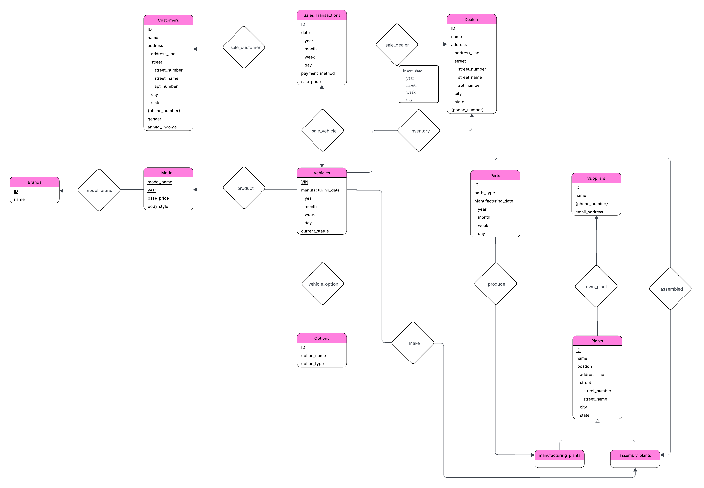
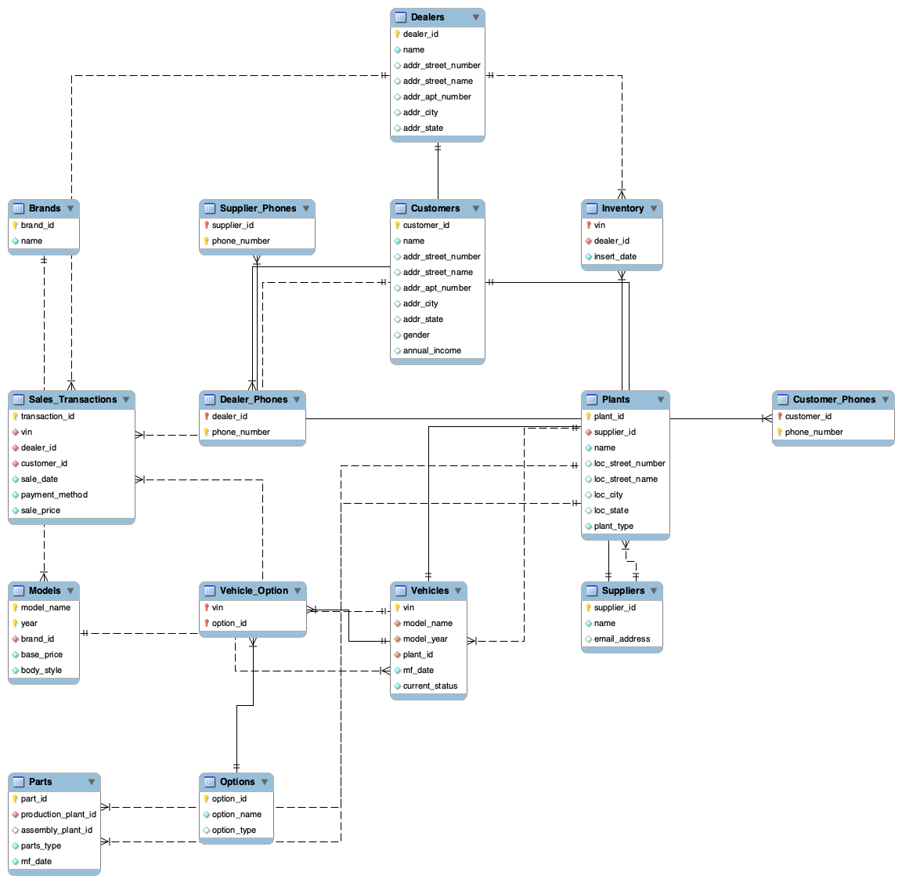
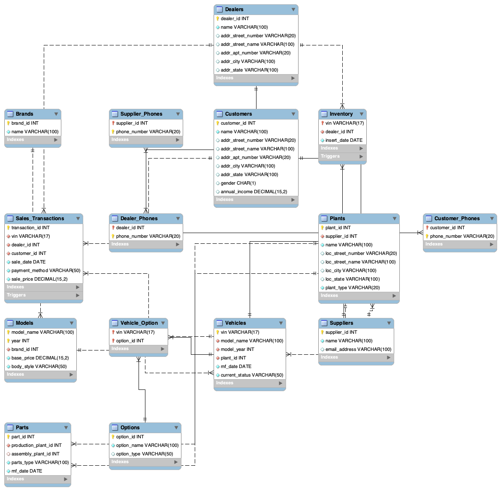

# Automobile Company Database — 자동차 회사 데이터베이스 설계 및 구현

> 서강대학교 **CSE4110 데이터베이스시스템** (2026-1학기) · Project 1 & 2 · 개인 과제

GM·Toyota 같은 자동차 회사의 운영 데이터베이스를 **개념적 설계(ERD) → 관계형 스키마 변환 → MySQL 구현 → C++ 애플리케이션**까지 단계적으로 만든 프로젝트.
브랜드 → 모델 → 차량의 생산 계층, 부품 공급망(공급자·공장·부품), 딜러 재고와 매출 거래까지 회사 전반의 업무 흐름을 다루고, 주어진 7개의 Sample Query를 처리.

| | 단계 | 주요 내용 | 문서 |
|---|---|---|---|
| **Project 1** | 개념적 설계 | E-R Diagram 작성, Sample Query 처리 경로 검증 | [`project1/`](project1/) |
| **Project 2** | 논리적·물리적 설계 및 구현 | 관계형 스키마 변환, BCNF 검증, MySQL 구현, 비즈니스 규칙 검증, C++ 애플리케이션 | [`project2/docs/design-report.md`](project2/docs/design-report.md) |

**Tech Stack**: MySQL 8.0+ · C++17 · MySQL C API · ODBC · Lucidchart

---

## Repository Structure

```
automobile-company-db/
├── project1/                    # Project 1 — 개념적 설계
│   ├── README.md                #   Entity / Relationship Sets, Sample Query 경로 요약
│   ├── docs/design-report.md    #   설계 보고서
│   └── images/ERD.png           #   E-R Diagram
└── project2/                    # Project 2 — 관계형 스키마 & 구현
    ├── database/
    │   ├── schema.sql           #   테이블 15개, 제약조건, 인덱스, 트리거
    │   └── sample_data.sql      #   샘플 데이터 (AI 생성)
    ├── docs/
    │   ├── design-report.md     #   설계 보고서 (스키마 변환, BCNF, 쿼리, 검증)
    │   ├── logical_schema.png
    │   ├── physical_schema.png
    │   └── images/              #   쿼리 결과·검증 스크린샷
    └── src/                     #   (AI 생성)
        ├── main.cpp             #   메뉴 기반 콘솔 애플리케이션 (Q1~Q7)
        ├── database.h           #   MySQL C API / ODBC 공통 facade
        └── README.md            #   빌드·실행 가이드
```

---

## Project 1 — E-R Diagram



- 엔티티 10개(Brands, Models, Vehicles, Options, Parts, Plants, Suppliers, Dealers, Customers, Sales_Transactions)와 relationship set 11개로 구성
- Plants는 manufacturing_plants / assembly_plants로 disjoint specialization
- 날짜는 연·월·주 단위 트렌드 분석을 위해 `year / month / week / day` composite attribute로 설계
- 7개의 Sample Query가 ERD 상에서 어떤 경로로 처리되는지 검증

자세한 내용: [`project1/README.md`](project1/README.md) · [`project1/docs/design-report.md`](project1/docs/design-report.md)

---

## Project 2 — 관계형 스키마 & 구현

| Logical Schema | Physical Schema |
|---|---|
|  |  |

- **스키마 변환**: 강의자료의 reduction rule로 ERD를 15개의 relation으로 변환. 날짜 attribute는 `DATE` 단일 attribute로 바꾸고, 두 종류의 공장은 판별자(`plant_type`)를 둔 Plants 테이블로 통합
- **BCNF 검증**: 모든 relation이 BCNF를 만족함을 확인. 기존 ERD의 `(year, month, day) → week` 종속성은 `DATE`로 통일해 제거
- **제약조건**: PK/FK, `ON DELETE CASCADE`, UNIQUE, NOT NULL, CHECK, DEFAULT, 그리고 입고·판매 시 차량 상태(`current_status`)를 자동 갱신하는 TRIGGER
- **비즈니스 규칙 검증**: 애플리케이션을 거치지 않고 SQL로 직접 위반을 시도해 8가지 제약이 DBMS 수준에서 작동함을 확인
- **C++ 애플리케이션**: MySQL C API와 ODBC 두 백엔드를 `database.h`의 공통 facade로 감싸고, 모든 사용자 입력은 prepared statement로 바인딩해 SQL injection 방지

> **AI 활용 안내**
> - C++ 애플리케이션 코드(`project2/src/`)와 샘플 데이터(`project2/database/sample_data.sql`)는 AI를 활용해 생성.
> - ERD 설계, 관계형 스키마 변환 및 BCNF 검증, 스키마 구현(`schema.sql`), 설계 보고서는 직접 작성.

### Sample Queries

| # | Query | 주요 SQL 기법 |
|---|---|---|
| Q1 | **Sales Trends** — 최근 3년 브랜드별 연·월·주 판매 추이 (성별·소득 구간별) | 다중 JOIN, `CASE`, `WEEK(date, 3)` |
| Q2 | **Defective Part Tracking** — 결함 부품이 장착된 차량 VIN과 구매 고객 | `LEFT OUTER JOIN`, 파라미터 바인딩 |
| Q3 | **Top Brands by Revenue** — 작년 매출액 상위 2개 브랜드 | `SUM`, `ORDER BY`, `LIMIT` |
| Q4 | **Top Brands by Unit Sales** — 작년 판매량 상위 2개 브랜드 | `COUNT`, `ORDER BY`, `LIMIT` |
| Q5 | **Seasonal Sales Patterns** — body style별 최다 판매 월 (동률 포함) | `WITH`, `MAX` 서브쿼리 |
| Q6 | **Dealer Inventory Efficiency** — 평균 재고 보유 기간이 가장 긴 딜러 | `WITH`, `DATEDIFF`, `AVG` |
| Q7 | **Supplier Coverage** — 가장 많은 모델에 부품을 공급하는 공급자 | `WITH`, `COUNT(DISTINCT)` |

### Quick Start

```bash
# 1. DB 생성 및 샘플 데이터 적재
mysql -u <user> -p < project2/database/schema.sql
mysql -u <user> -p < project2/database/sample_data.sql

# 2. 빌드 (MySQL C API)
cd project2/src
g++ -std=c++17 -O2 -Wall main.cpp -o car_db_app $(mysql_config --cflags --libs)

# 3. 실행
./car_db_app
```

ODBC 빌드, Windows 빌드, 파라미터 입력 예시는 [`project2/src/README.md`](project2/src/README.md) 참고.

자세한 설계 내용: [`project2/docs/design-report.md`](project2/docs/design-report.md)
