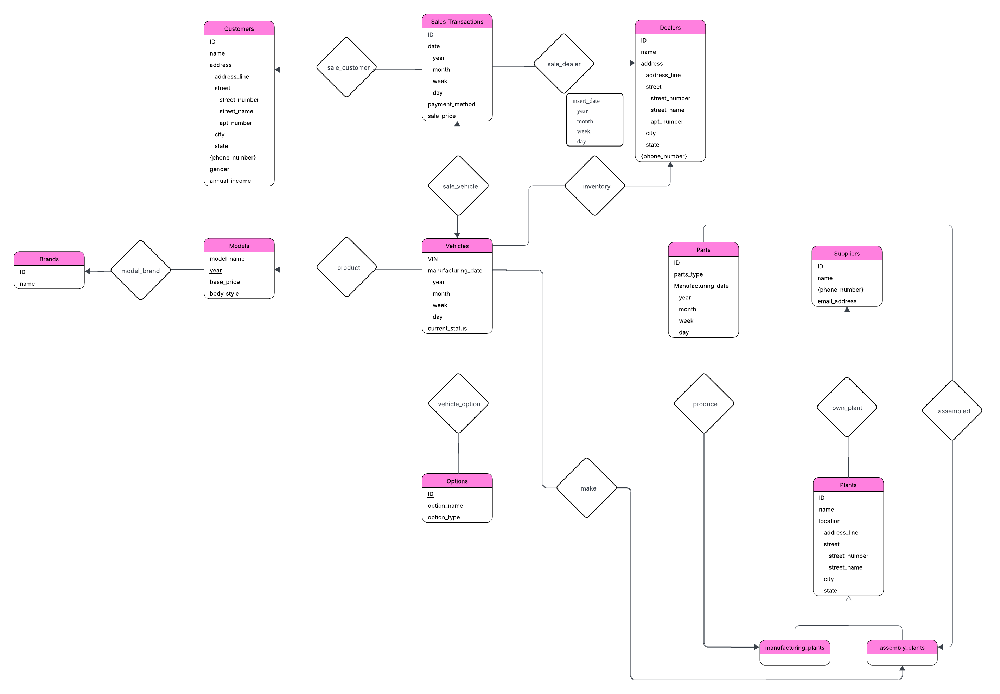

# Automobile Company ERD — 자동차 회사 개념적 데이터베이스 설계

> 서강대학교 **CSE4110 데이터베이스시스템** (2026-1학기) · Project 1 · 개인 과제

GM·Toyota 같은 자동차 회사의 운영 데이터를 설계한 프로젝트.
브랜드 → 모델 → 차량의 생산 계층, 부품 공급망(공급자·공장·부품), 딜러 재고와 매출 거래까지 회사 전반의 업무 흐름을 하나의 ERD로 표현하고, 주어진 7개의 Sample Query를 이 모델로 처리할 수 있는지 검증.

- **범위**: 개념적 설계(ERD)
- **도구**: Lucidchart
- **표기법**: 교재(Silberschatz, *Database System Concepts*) 기준 Chen 표기법

---

## E-R Diagram

**표기 읽는 법**

| 표기 | 의미 |
|---|---|
| 밑줄 attribute | Primary Key |
| `{ }` attribute | Multivalued attribute |
| 들여쓰기된 attribute | Composite attribute의 하위 attribute |
| 화살표(→) | 화살표가 가리키는 쪽이 "one" (1:N의 1쪽) |
| 이중선(═) | Total participation |
| 빈 삼각형(△) | Specialization (disjoint) |
| 관계에 점선으로 연결된 박스 | Relationship attribute |

---

## Entity Sets

| Entity | 설명 | Primary Key | 주요 attribute / 설계 포인트 |
|---|---|---|---|
| **Brands** | 자동차 브랜드 | `ID` | 이름이 같은 브랜드가 있을 수 있어 대리키 사용 |
| **Models** | 브랜드가 생산한 모델 | `(model_name, year)` | 같은 모델도 디자인 연도별로 가격·스타일이 달라 복합키 사용. `base_price`, `body_style` |
| **Vehicles** | 실제 생산된 개별 차량 | `VIN` | `manufacturing_date`(year/month/week/day composite attribute), `current_status` |
| **Options** | 색상·엔진·변속기 등 옵션 | `ID` | 옵션 종류 추가가 쉽도록 attribute가 아닌 별도 entity set으로 분리 |
| **Parts** | 차량 조립용 부품 | `ID` | 결함 추적을 위해 개별 부품 단위로 식별, `manufacturing_date` composite attribute |
| **Plants** | 공장 (상위 entity set) | `ID` | `location`(composite attribute). **manufacturing_plants / assembly_plants로 disjoint specialization** |
| **Suppliers** | 부품 공급자 | `ID` | `{phone_number}`(multivalued attribute), `email_address` |
| **Dealers** | 차량 판매 딜러 | `ID` | `address`(composite attribute), `{phone_number}` |
| **Customers** | 차량 구매 고객 | `ID` | sales trends 분석용 `gender`, `annual_income` 포함 |
| **Sales_Transactions** | 매출 거래 기록 | `ID` | `date`(year/month/week/day), `payment_method`, `sale_price` |

> 날짜 attribute는 연·월·주 단위 트렌드 분석을 위해 `year / month / week / day` composite attribute로 구성.

---

## Relationship Sets

| Relationship | 연결 | Cardinality | Participation | 설명 |
|---|---|---|---|---|
| `model_brand` | Models — Brands | N : 1 | Models **total** / Brands partial | 모든 모델은 하나의 브랜드에 속함 |
| `product` | Vehicles — Models | N : 1 | Vehicles **total** / Models partial | 아직 생산되지 않은 모델 허용 |
| `vehicle_option` | Vehicles — Options | M : N | Vehicles **total** / Options partial | 색상·엔진 등 필수 옵션 존재 |
| `make` | Vehicles — assembly_plants | N : 1 | 양쪽 **total** | 모든 차량은 조립공장을 거침 |
| `produce` | Parts — manufacturing_plants | N : 1 | 양쪽 **total** | 부품을 생산한 공장 |
| `assembled` | Parts — assembly_plants | N : 1 | 양쪽 partial | 부품이 조립공장으로 전달 (결함품은 미전달 가능) |
| `own_plant` | Plants — Suppliers | N : 1 | Plants **total** / Suppliers partial | 공급자가 소유한 공장 |
| `inventory` | Vehicles — Dealers | N : 1 | 양쪽 partial | 관계속성 **`insert_date`** 로 입고일 기록 |
| `sale_vehicle` | Sales_Transactions — Vehicles | 1 : 1 | Sales **total** / Vehicles partial | 차량 1대 = 거래 1건 |
| `sale_dealer` | Sales_Transactions — Dealers | N : 1 | Sales **total** / Dealers partial | 거래를 담당한 딜러 |
| `sale_customer` | Sales_Transactions — Customers | N : 1 | Sales **total** / Customers partial | 거래한 고객 (미구매 등록 고객 허용) |

---

## Sample Query 처리 경로

| # | 질의 | 탐색 경로 |
|---|---|---|
| 1 | **Sales Trends** — 최근 3년 브랜드별 연·월·주 판매 추이, 성별·소득 구간별 분석 | Brands → `model_brand` → Models → `product` → Vehicles → `sale_vehicle` → Sales_Transactions → `sale_customer` → Customers |
| 2 | **Defective Part Tracking** — 특정 공급자(Getrag)가 특정 기간 생산한 변속기가 들어간 차량 VIN과 구매 고객 | Suppliers → `own_plant` → Plants → `produce` → Parts → `assembled` → assembly_plants → `make` → Vehicles → `sale_vehicle` → Sales_Transactions → `sale_customer` → Customers |
| 3 | **Top Brands by Revenue** — 작년 매출액 상위 2개 브랜드 | Sales_Transactions → `sale_vehicle` → Vehicles → `product` → Models → `model_brand` → Brands (`sale_price` 합계) |
| 4 | **Top Brands by Unit Sales** — 작년 판매량 상위 2개 브랜드 | 3번과 동일 경로 (거래 건수 집계) |
| 5 | **Seasonal Sales Patterns** — 컨버터블이 가장 잘 팔리는 달 | Models(`body_style`) → `product` → Vehicles → `sale_vehicle` → Sales_Transactions(`date.month`) |
| 6 | **Dealer Inventory Efficiency** — 평균 재고 보유 기간이 가장 긴 딜러 | Dealers → `inventory`(`insert_date`) → Vehicles → `sale_vehicle` → Sales_Transactions(`date`) |
| 7 | **Supplier Coverage** — 가장 많은 모델에 부품을 공급하는 공급자 | Suppliers → `own_plant` → Plants → `produce` → Parts → `assembled` → assembly_plants → `make` → Vehicles → `product` → Models |

자세한 설명은 [`docs/design-report.md`](docs/design-report.md)에 정리.

---