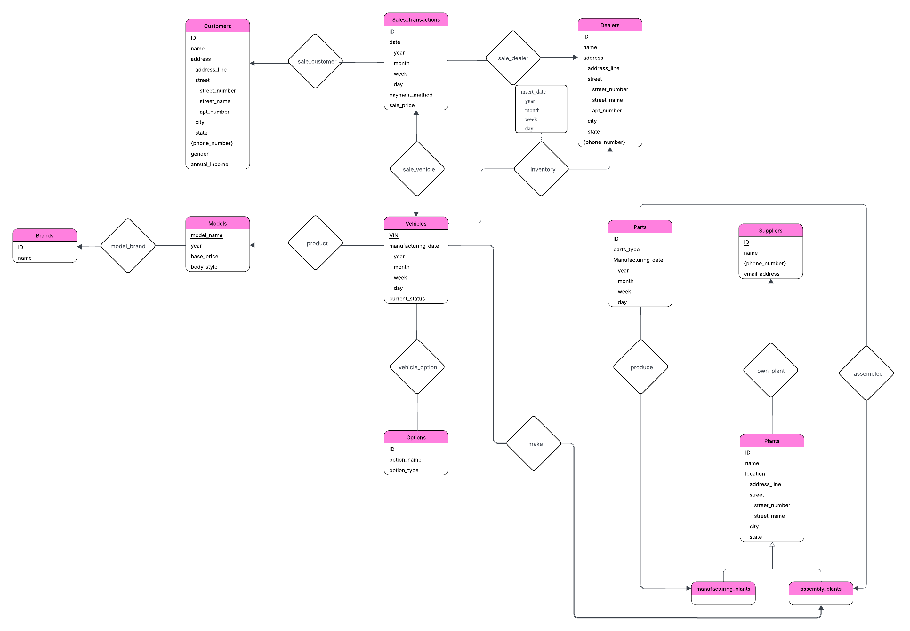

# 설계 보고서 — Automobile Company ERD

> CSE4110 데이터베이스시스템 Project 1 (2026 Spring) 제출 보고서를 정리한 문서.



## 목차
1. [Entity Sets](#1-entity-sets)
2. [Relationship Sets](#2-relationship-sets)
3. [Sample Query 처리 방법](#3-sample-query-처리-방법)

---

## 1. Entity Sets

### 1) Brands
- **의미**: 자동차 브랜드
- **attribute**: `ID`, `name`
- **PK 선택 이유**: 이름이 같은 브랜드가 있을 수 있으므로 `name` 대신 `ID`를 PK로 사용했다.

### 2) Models
- **의미**: 브랜드가 생산한 자동차 모델
- **attribute**: `model_name`, `year`(디자인 연도), `base_price`, `body_style`
- **PK 선택 이유**: 같은 모델이라도 디자인 연도에 따라 스타일이나 가격이 다를 수 있으므로 `(model_name, year)`를 복합 PK로 선택했다.

### 3) Vehicles
- **의미**: 실제로 생산된 개별 차량
- **attribute**: `VIN`, `manufacturing_date`, `current_status`
- **설계 포인트**
  - 각 차량을 개별적으로 식별하기 위해 `VIN`을 PK로 사용했다.
  - 조회 편의를 위해 `manufacturing_date`를 `year / month / week / day` composite attribute로 구성했다.

### 4) Options
- **의미**: 차량에 적용되는 옵션 (색상, 엔진 타입, 변속기 등)
- **attribute**: `ID`, `option_name`, `option_type`
- **설계 포인트**: 새로운 옵션 종류를 쉽게 추가할 수 있도록 Vehicles의 attribute가 아닌 별도 entity set으로 분리했다.

### 5) Parts
- **의미**: 차량 조립에 필요한 부품
- **attribute**: `ID`, `parts_type`, `manufacturing_date`
- **설계 포인트**
  - 부품 공급 현황 파악과 결함 추적을 위해 만든 entity set이다.
  - 개별 부품을 식별하기 위해 `ID`를 PK로 사용했다.
  - `manufacturing_date`는 `year / month / week / day` composite attribute로 구성했다.

### 6) Plants
- **의미**: 공장
- **attribute**: `ID`, `name`, `location`(`address_line`, `street`, `city`, `state`)
- **설계 포인트**
  - 공장은 **제조공장(manufacturing_plants)** 과 **조립공장(assembly_plants)** 두 종류가 있으므로 specialization으로 표현했다.
  - 제조공장이면서 동시에 조립공장인 경우는 없다고 보고 **disjoint**로 설정했다.
  - 하위 entity set은 상속받은 attribute 외에 별도 attribute가 필요 없다고 판단했다.

### 7) Suppliers
- **의미**: 부품 공급자
- **attribute**: `ID`, `name`, `{phone_number}`, `email_address`
- **설계 포인트**
  - 전화번호는 여러 개일 수 있으므로 **multivalued attribute**로 설정했다.
  - 업무용 이메일은 보통 하나만 사용한다고 보고 일반 attribute로 설정했다.

### 8) Dealers
- **의미**: 차량을 판매하는 딜러
- **attribute**: `ID`, `name`, `address`, `{phone_number}`
- **설계 포인트**: `address`는 조회 편의를 위해 `address_line`, `street`(`street_number`, `street_name`, `apt_number`), `city`, `state`의 composite attribute로 구성했다.

### 9) Customers
- **의미**: 차량을 구매하는 고객
- **attribute**: `ID`, `name`, `address`, `{phone_number}`, `gender`, `annual_income`
- **설계 포인트**: sales trends 분석에 필요한 `gender`와 `annual_income`을 포함했다.

### 10) Sales_Transactions
- **의미**: 매출 거래 기록
- **attribute**: `ID`, `date`, `payment_method`, `sale_price`
- **설계 포인트**: 일반적인 날짜 정보(year, month, day) 외에 sales trend 파악을 위해 `week`를 추가했다.

---

## 2. Relationship Sets

### 1) model_brand — Models : Brands = N : 1
- 모델이 어느 브랜드에 속하는지를 나타낸다.
- 하나의 브랜드는 여러 모델을 출시할 수 있으므로 1:N 관계이다.
- 모델이 없는 브랜드는 있을 수 있지만 브랜드가 없는 모델은 없으므로 **Models: total**, Brands: partial.

### 2) product — Vehicles : Models = N : 1
- 모델을 바탕으로 실제 생산된 차량을 나타낸다.
- 하나의 모델은 여러 대의 차량으로 생산될 수 있으므로 1:N 관계이다.
- 모든 차량은 모델이 있지만, 아직 생산된 차량이 없는 모델은 있을 수 있으므로 **Vehicles: total**, Models: partial.

### 3) vehicle_option — Vehicles : Options = M : N
- 차량에 적용된 세부 옵션을 나타낸다.
- 한 차량은 여러 옵션을 가질 수 있고, 하나의 옵션도 여러 차량에 적용될 수 있으므로 M:N 관계이다.
- 색상·엔진 타입 등 필수 옵션이 있으므로 **Vehicles: total**, 적용된 차량이 없는 옵션도 있을 수 있으므로 Options: partial.

### 4) make — Vehicles : assembly_plants = N : 1
- 조립공장에서 차량을 만드는 공정을 나타낸다.
- 한 공장에서 여러 대의 차량을 조립할 수 있으므로 1:N 관계이다.
- 조립공장을 거치지 않은 차량은 없고 차량을 조립하지 않는 조립공장도 없으므로 **양쪽 모두 total**.

### 5) produce — Parts : manufacturing_plants = N : 1
- 어떤 공장에서 어떤 부품이 생산되었는지를 나타낸다.
- 한 공장에서 여러 부품을 생산하므로 1:N 관계이다.
- 모든 부품은 생산 공장이 있고 부품을 만들지 않는 제조공장은 없으므로 **양쪽 모두 total**.

### 6) assembled — Parts : assembly_plants = N : 1
- 부품이 조립공장으로 전달되는 것을 나타낸다. (Parts는 개별 부품 단위)
- 한 조립공장에 여러 부품이 전달되므로 1:N 관계이다.
- 부품이 전달되지 않은 공장도, 공장에 전달되지 않은 부품(결함품 등)도 있을 수 있으므로 **양쪽 모두 partial**.

### 7) own_plant — Plants : Suppliers = N : 1
- 공급자가 소유한 공장을 나타낸다.
- 한 공급자는 여러 공장을 소유할 수 있으므로 1:N 관계이다.
- 공장을 소유하지 않은 공급자도 있을 수 있으므로 Suppliers: partial, 공장은 항상 소유자가 있다고 보고 **Plants: total**.

### 8) inventory — Vehicles : Dealers = N : 1
- 딜러가 보유한 재고 차량을 나타낸다.
- **관계속성 `insert_date`** 를 두어 딜러의 인벤토리 효율성을 측정할 수 있도록 했다.
- 한 딜러는 여러 차량을 보유할 수 있으므로 1:N 관계이다.
- 차량이 없는 딜러, 아직 어떤 딜러에게도 배정되지 않은 차량이 있을 수 있으므로 **양쪽 모두 partial**.

### 9) sale_vehicle — Sales_Transactions : Vehicles = 1 : 1
- 매출 거래와 판매된 차량을 연결한다.
- 한 차량은 한 번의 거래로만 판매되므로 1:1 관계이다.
- 판매되지 않은 차량이 있을 수 있으므로 Vehicles: partial, 거래에는 반드시 차량이 필요하므로 **Sales_Transactions: total**.

### 10) sale_dealer — Sales_Transactions : Dealers = N : 1
- 거래를 담당한 딜러를 나타낸다.
- 한 딜러가 여러 거래를 할 수 있으므로 1:N 관계이다.
- 거래에 참여하지 않은 딜러가 있을 수 있으므로 Dealers: partial, 거래에는 반드시 딜러가 필요하므로 **Sales_Transactions: total**.

### 11) sale_customer — Sales_Transactions : Customers = N : 1
- 거래한 고객을 나타낸다.
- 한 고객은 여러 거래를 할 수 있으므로 1:N 관계이다.
- 등록만 되어 있고 구매하지 않은 고객이 있을 수 있으므로 Customers: partial, 거래에는 반드시 고객이 필요하므로 **Sales_Transactions: total**.

---

## 3. Sample Query 처리 방법

### Q1. Sales Trends
> 최근 3년간 브랜드별 판매 추이를 연·월·주 단위로 보이고, 구매자 성별과 소득 구간별로 세분화하라.

```
Brands → model_brand → Models → product → Vehicles → sale_vehicle → Sales_Transactions
                                                                      └→ sale_customer → Customers
```
- Brands에서 출발해 `model_brand`, `product`, `sale_vehicle`을 거치면 Sales_Transactions에 도달한다.
- 연·월·주별 추이는 `Sales_Transactions.date`의 composite attribute로 구한다.
- 성별·소득 구간별 분석은 `sale_customer`로 Customers에 접근해 `gender`, `annual_income`을 사용한다.

### Q2. Defective Part Tracking
> 공급자 Getrag가 특정 기간에 생산한 변속기가 결함으로 밝혀졌을 때, 해당 변속기가 장착된 차량의 VIN과 구매 고객을 찾아라.

```
Suppliers → own_plant → Plants → produce → Parts → assembled → assembly_plants
          → make → Vehicles → sale_vehicle → Sales_Transactions → sale_customer → Customers
```
- Suppliers에서 `own_plant`, `produce`로 결함 부품을 생산한 공장과 해당 기간(`Parts.manufacturing_date`)의 부품을 찾는다.
- `assembled`, `make`를 거쳐 그 부품이 들어간 차량(Vehicles)에 도달한다.
- `sale_vehicle`로 판매 정보를, `sale_customer`로 구매 고객 정보를 얻어 리콜 조치를 취할 수 있다.
- 공장 단위로 추적하므로 "Getrag의 특정 공장 하나"로 범위를 좁히는 것도 가능하다.

### Q3. Top Brands by Revenue / Q4. Top Brands by Unit Sales
> 작년 매출액(Q3) / 판매 대수(Q4) 기준 상위 2개 브랜드를 찾아라.

```
Sales_Transactions → sale_vehicle → Vehicles → product → Models → model_brand → Brands
```
- 판매 날짜와 가격은 Sales_Transactions에, 판매 차량과 모델 정보는 Vehicles·Models에 있다.
- 브랜드별로 `sale_price`를 합산하면 Q3, 거래 건수를 세면 Q4를 처리할 수 있다.

### Q5. Seasonal Sales Patterns
> 컨버터블은 몇 월에 가장 잘 팔리는가?

```
Models → product → Vehicles → sale_vehicle → Sales_Transactions
```
- `Models.body_style = 'convertible'`인 차량의 판매 기록을 `Sales_Transactions.date.month`별로 집계한다.

### Q6. Dealer Inventory Efficiency
> 차량을 재고로 가장 오래 보유하는 딜러를 찾아라.

```
Dealers → inventory(insert_date) → Vehicles → sale_vehicle → Sales_Transactions(date)
```
- `inventory`의 관계속성 `insert_date`(입고일)와 `Sales_Transactions.date`(판매일)의 차이로 보유 기간을 구하고, 딜러별 평균을 비교한다.

### Q7. Supplier Coverage
> 모든 브랜드를 통틀어 가장 많은 수의 서로 다른 모델에 부품을 공급하는 공급자는?

```
Suppliers → own_plant → Plants → produce → Parts → assembled → assembly_plants
          → make → Vehicles → product → Models
```
- 공급자가 생산한 부품은 Suppliers → manufacturing_plants → Parts 경로로 구한다.
- 그 부품이 조립된 차량은 assembly_plants → Vehicles, 그 차량의 모델은 Models에서 찾는다.
- 공급자별로 서로 다른 `(model_name, year)`의 수를 세면 된다.
