# 설계 보고서 — Car Manufacturing DB (Project 2)

> CSE4110 데이터베이스시스템 Project 2 (2026 Spring) 제출 보고서를 정리한 문서.
> Project 1에서 설계한 ERD를 관계형 스키마로 변환하고, MySQL과 C++ 애플리케이션으로 구현했다.

## 목차
1. [ERD → 관계형 스키마 변환](#1-erd--관계형-스키마-변환)
2. [BCNF 검증](#2-bcnf-검증)
3. [생성 데이터](#3-생성-데이터)
4. [쿼리 실행](#4-쿼리-실행)
5. [Validation of business rule enforcement](#5-validation-of-business-rule-enforcement)
6. [C++ Application 설명](#6-c-application-설명)

---

## 1. ERD → 관계형 스키마 변환

| Logical Schema | Physical Schema |
|---|---|
| 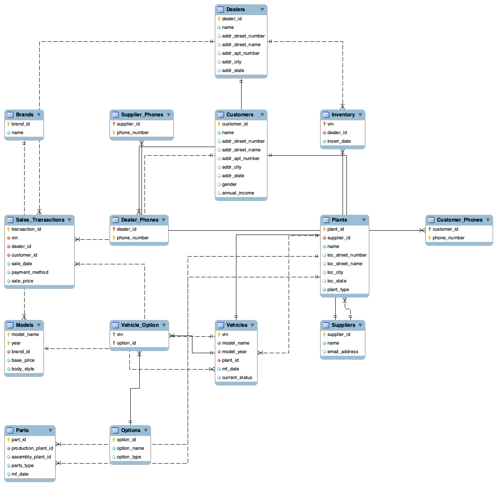 | 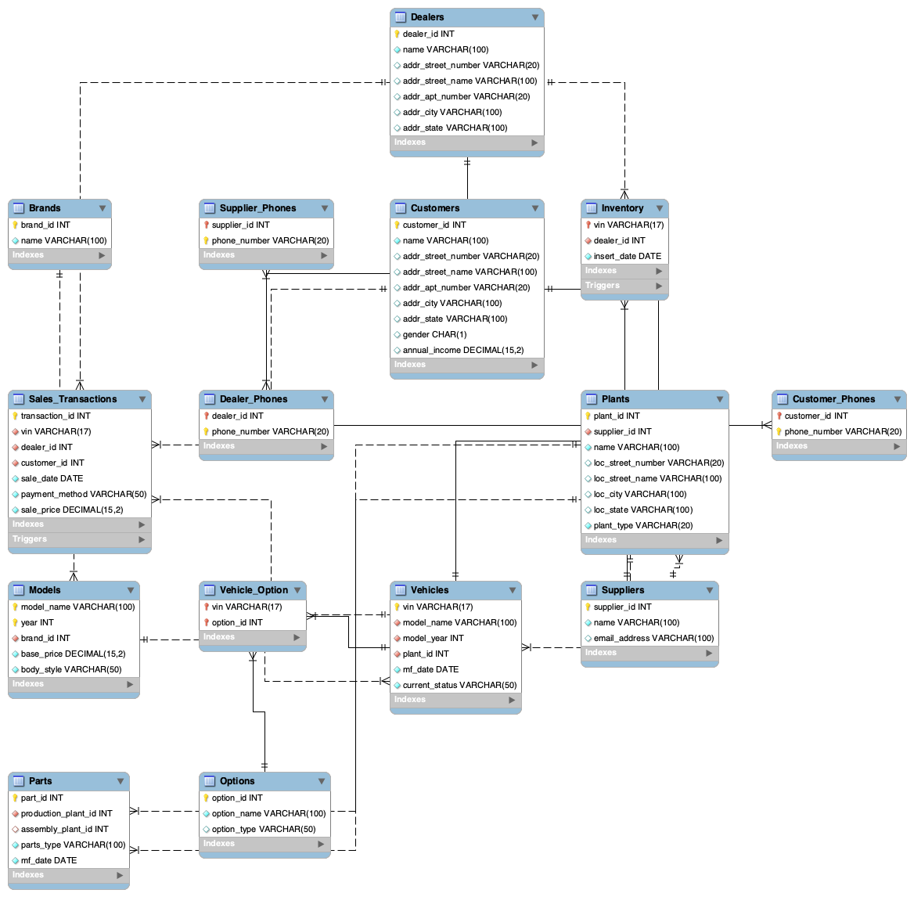 |

### 스키마 변환 규칙
강의자료의 표준 reduction rule을 이용하여 기존 ERD를 15개의 relation으로 변환하였다.

| # | 규칙 | 변환 방법 |
|---|---|---|
| 1 | Strong entity | 하나의 엔티티를 하나의 relation으로 생성. 기존 ERD의 엔티티는 모두 strong entity였기 때문에 모든 엔티티에 이 규칙을 적용했다. |
| 2 | Composite attribute | 상위 속성을 제거하고 하위 속성만을 attribute로 포함 |
| 3 | Multi-valued attribute | 별도의 relation으로 분리하여 저장 |
| 4 | 1:1 relationship | 한쪽의 PK를 다른 쪽에 FK로 추가 |
| 5 | 1:N relationship | N 부분에 1의 PK를 FK로 추가 |
| 6 | N:M relationship | 양쪽의 PK를 PK로 가지는 별도의 relation을 추가 |
| 7 | 관계 속성이 있는 1:N | 관계 자체를 별도 relation으로 분리하여 관계 속성을 저장 |
| 8 | 상속관계 | 하위 속성을 판별하는 판별자 attribute를 추가 |

### 총 변환 결과

| # | Relation | PK | 주요 FK |
|---|---|---|---|
| 1 | Brands | `brand_id` | — |
| 2 | Models | `(model_name, year)` | `brand_id` → Brands |
| 3 | Suppliers | `supplier_id` | — |
| 4 | Supplier_Phones | `(supplier_id, phone_number)` | `supplier_id` → Suppliers |
| 5 | Plants | `plant_id` | `supplier_id` → Suppliers |
| 6 | Vehicles | `vin` | `(model_name, model_year)` → Models, `plant_id` → Plants |
| 7 | Options | `option_id` | — |
| 8 | Vehicle_Option | `(vin, option_id)` | `vin` → Vehicles, `option_id` → Options |
| 9 | Parts | `part_id` | `production_plant_id` → Plants, `assembly_plant_id` → Plants |
| 10 | Dealers | `dealer_id` | — |
| 11 | Dealer_Phones | `(dealer_id, phone_number)` | `dealer_id` → Dealers |
| 12 | Customers | `customer_id` | — |
| 13 | Customer_Phones | `(customer_id, phone_number)` | `customer_id` → Customers |
| 14 | Sales_Transactions | `transaction_id` | `vin` (UNIQUE) → Vehicles, `dealer_id` → Dealers, `customer_id` → Customers |
| 15 | Inventory | `vin` | `vin` → Vehicles, `dealer_id` → Dealers |

### 기존 ERD에서의 변경사항
기존 ERD가 대부분 BCNF를 만족하여 수정사항은 많지 않았다.

1. **날짜 attribute 단일화**: year, month, week, day로 나누어져 있던 날짜 관련 attribute를 `DATE` 자료형을 이용한 단일 attribute로 변경하였다. (이후 SQL의 시계열 함수를 통해 값을 변환)
2. **Plants 통합**: Manufacturing_Plants, Assembly_Plants를 Plants 테이블로 통합하였다. 두 하위 엔티티는 추가 속성이 없기 때문에 판별자(`plant_type`)를 추가한 뒤 한 테이블로 통합하였다.

### Data Type 선정 근거

| Data Type | 적용된 데이터 | 이유 |
|---|---|---|
| `INT` | PK, FK, 연도값 | 대부분의 PK가 ID 형태로 이루어져 있기 때문에 INT형 사용 |
| `VARCHAR(17)` | VIN (차량 식별번호) | ISO 3779 표준에 따라 정확히 17자로 설정 (알파벳, 숫자가 섞인 형태) |
| `VARCHAR(20)` | 전화번호, 주소의 번지·호수, 짧은 분류값 | `-`이나 알파벳, 정수가 섞인 attribute이기 때문에 가변 문자열 사용 |
| `VARCHAR(50)` | 차종·결제수단·차량 상태 등 분류값 | enum 성격이지만 ENUM 타입 대신 VARCHAR + CHECK로 확장성 확보 |
| `VARCHAR(100)` | 회사명, 인명, 주소, 이메일, 부품 종류 | 정해진 길이가 없는 attribute이기 때문에 가변 문자열 사용 |
| `CHAR(1)` | 성별 | 값이 한 글자로 고정이므로 VARCHAR가 아닌 CHAR 사용 |
| `NUMERIC(15,2)` | 화폐 금액 (차량 가격, 연소득 등) | 연소득이나 화폐 가격은 소수로 나올 수 있기 때문에 NUMERIC 사용 |
| `DATE` | 제조일, 판매일, 입고일 등 모든 날짜 | 시계열 함수를 통해 year, month, week에 접근 가능 |

### Constraints

| Constraint | 적용된 데이터 | 이유 |
|---|---|---|
| PRIMARY KEY | 모든 relation의 식별 컬럼 | 각 row를 유일하게 식별 |
| FOREIGN KEY | 다른 relation을 참조하는 모든 컬럼 | 참조 무결성 보장 |
| FK + CASCADE | 전화번호·옵션 등 부모에 종속된 데이터 | 부모 삭제 시 필요 없는 데이터가 되기 때문에 삭제 |
| UNIQUE | 브랜드명, 판매된 VIN | 중복 불가능 값에 대한 처리 |
| NOT NULL | 도메인상 반드시 값이 있어야 하는 컬럼 (날짜, 금액, 이름, enum 등) | 필수 데이터에 대한 처리 |
| CHECK | 금액 범위, 연도 범위, enum 값 | 범위나 값이 정해진 데이터에 대한 처리 |
| DEFAULT | 차량 초기 상태 | 입력 누락 시 합리적 기본값 자동 부여 |
| TRIGGER | 차량 상태 자동 갱신 | 여러 테이블 간 일관성을 DBMS가 자동 유지 |

---

## 2. BCNF 검증

| Relation | Functional Dependency | 판정 |
|---|---|---|
| Brands | `brand_id → name`, `name → brand_id` | 양쪽 모두 candidate key |
| Models | `(model_name, year) → brand_id, base_price, body_style` | 좌변이 PK |
| Suppliers | `supplier_id → name, email_address` | 좌변이 PK |
| Supplier_Phones | — | 비자명 FD 없음 (모든 attribute가 PK) |
| Plants | `plant_id → supplier_id, name, plant_type, loc_...` | 좌변이 PK |
| Vehicles | `vin → model_name, model_year, plant_id, mf_date, current_status` | 좌변이 PK |
| Options | `option_id → option_name, option_type` | 좌변이 PK |
| Vehicle_Option | — | 비자명 FD 없음 (모든 attribute가 PK) |
| Parts | `part_id → production_plant_id, assembly_plant_id, parts_type, mf_date` | 좌변이 PK |
| Dealers | `dealer_id → name, addr_...` | 좌변이 PK |
| Dealer_Phones | — | 비자명 FD 없음 (모든 attribute가 PK) |
| Customers | `customer_id → name, gender, annual_income, addr_...` | 좌변이 PK |
| Customer_Phones | — | 비자명 FD 없음 (모든 attribute가 PK) |
| Sales_Transactions | `transaction_id → 나머지`, `vin → 나머지` | `transaction_id`, `vin` 모두 candidate key |
| Inventory | `vin → dealer_id, insert_date` | 좌변이 PK |

**모든 relation이 BCNF를 만족한다.**

- 기존 ERD에서 week는 year, month, day를 통해 도출할 수 있었다(`(year, month, day) → week`). 이는 BCNF 위반이기 때문에 `DATE` 변수로 통일하여 BCNF 조건을 만족하도록 했다.
- 주소 또한 FD가 있다고 볼 수 있으나, 한국의 광주처럼 지역명이 같은 곳이 있을 경우 도메인상 강제되지 않기 때문에 현 스키마를 유지했다.

---

## 3. 생성 데이터

### 1) 생성 데이터의 수

| Relation | 개수 | 비고 |
|---|---|---|
| Brands | 10 | 실제 모델이 생성된 브랜드는 7개 |
| Models | 14 | |
| Suppliers | 14 | assembly plant를 소유한 내부 supplier 7, 공장을 소유하지 않은 외부 supplier 7 |
| Supplier_Phones | 15 | multi-valued attribute 확인을 위해 전화번호를 두 개 가진 supplier 생성 |
| Plants | 14 | Assembly 7, Manufacturing 7 |
| Vehicles | 30 | Sold 28, In Inventory 2 |
| Options | 12 | 6개의 type으로 분류 |
| Vehicle_Option | 24 | 차량별로 0~3개 사이의 옵션 부여 |
| Parts | 15 | 8개의 type으로 분류 |
| Dealers | 10 | |
| Dealer_Phones | 12 | Supplier_Phones와 동일한 이유로 2개 추가 |
| Customers | 16 | Male 8, Female 8, 소득은 $45,000 ~ $200,000 사이에 분포 |
| Customer_Phones | 18 | Supplier_Phones와 동일한 이유로 2개 추가 |
| Inventory | 30 | Sold 28, In Inventory 2 |
| Sales_Transactions | 28 | 거래방법: Loan, Cash, Credit Card, Lease, Bank Transfer 총 5종류 |

### 2) 생성 의도

- **Q1 (Sales Trends)**: 매출을 2023~2026 사이에 분포하도록 하여 정확히 3년간의 트렌드를 분석하는지 확인할 수 있도록 하였다. 성별과 소득은 최대한 다양한 구간에 분포하도록 하였고, 매출 28건은 모두 다른 날짜로 설정하여 다양한 주차를 검증할 수 있도록 하였다.
- **Q2 (Defective Part Tracking)**: 15가지 부품 모두 한 대 이상의 차량과 구매 고객에게 연결되도록 하여 부품별로 결과를 확인할 수 있도록 하였고, 판매되지 않은 차량 데이터를 생성하여 미판매 차량의 케이스도 검증할 수 있도록 하였다.
- **Q3 (Top Brands by Revenue)**: BMW를 압도적 1위로 만들어 정렬 기준을 정확하게 설정했는지 확인하고, 매출이 0건인 브랜드도 생성하여 결과에서 제외되는지 검증할 수 있도록 하였다.
- **Q4 (Top Brands by Unit Sales)**: 정렬 기준을 검증할 수 있도록 데이터를 생성하였다.
- **Q5 (Seasonal Sales Patterns)**: 여름에 convertible 스타일을 몰아넣어 추세를 나타낼 수 있도록 설계하였고, 동률 케이스를 만들어 모두 표시되는지 확인할 수 있도록 하였다.
- **Q6 (Dealer Inventory Efficiency)**: 의도적으로 오랫동안 팔리지 않았다가 팔린 차량 데이터를 생성하여 쿼리가 잘 작동하는지 확인하고, 평균 보유일은 최대한 다양하게 분포시켰다.
- **Q7 (Supplier Coverage)**: 3개의 공장에 부품을 보내 7개의 모델에 영향을 미치는 supplier를 만들어 쿼리가 잘 작동하는지 확인할 수 있도록 하였다.

데이터는 최대한 현실과 유사하도록 상호명과 가격대를 맞추었다.

---

## 4. 쿼리 실행

### Q1. Sales Trends

| year × gender | year × income range |
|---|---|
| 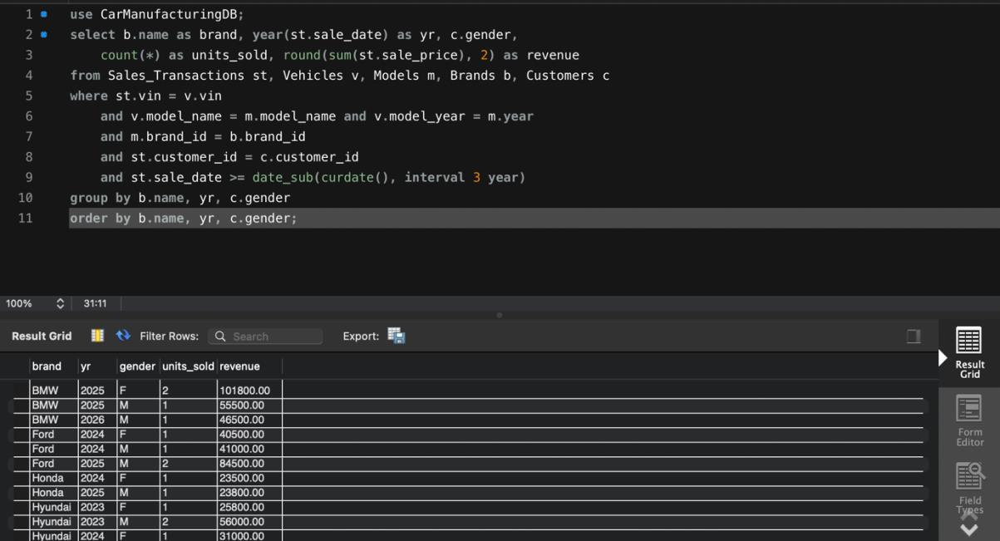 | 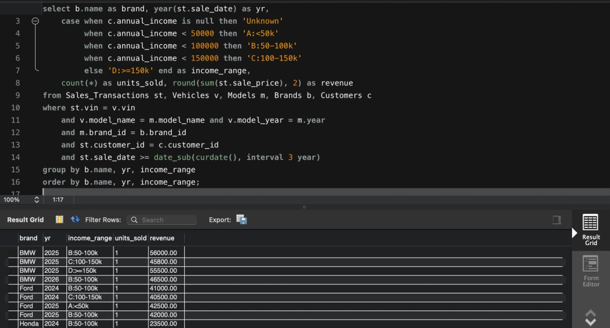 |

| month × gender | month × income range |
|---|---|
| 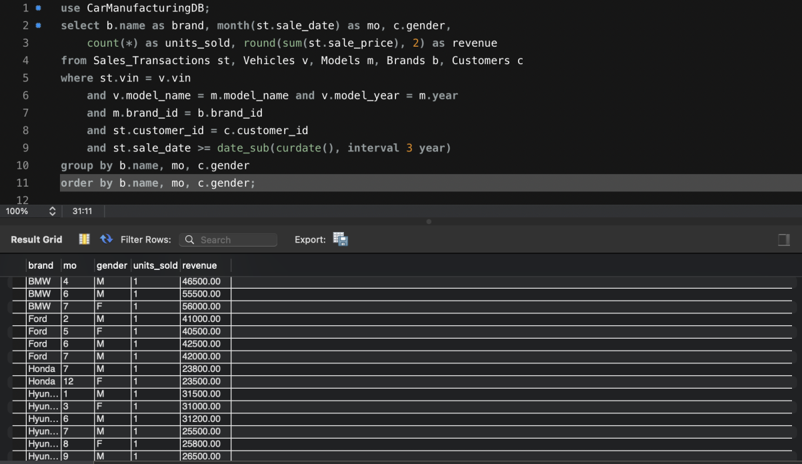 | 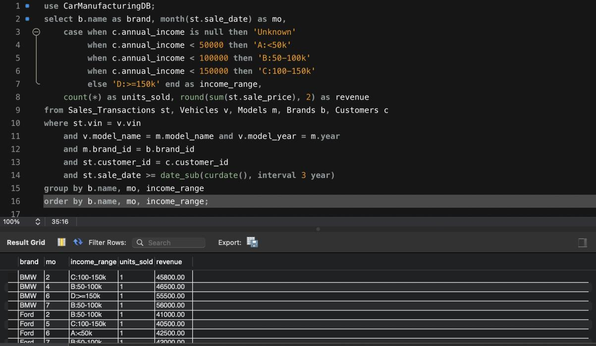 |

| week × gender | week × income range |
|---|---|
| 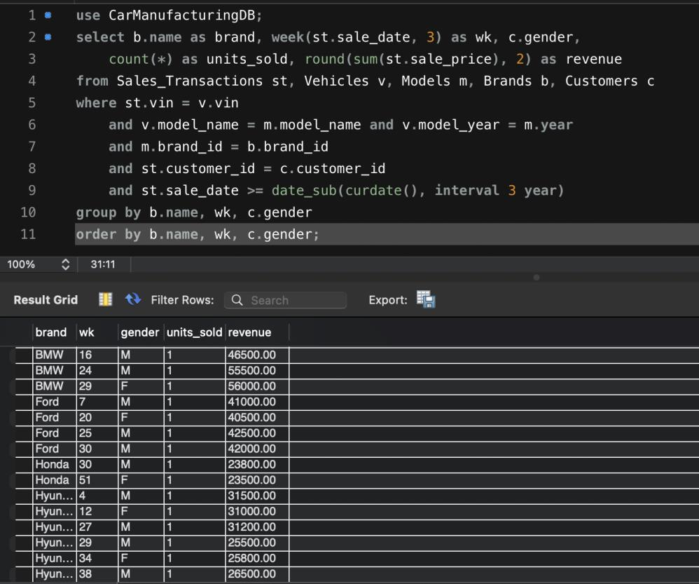 | 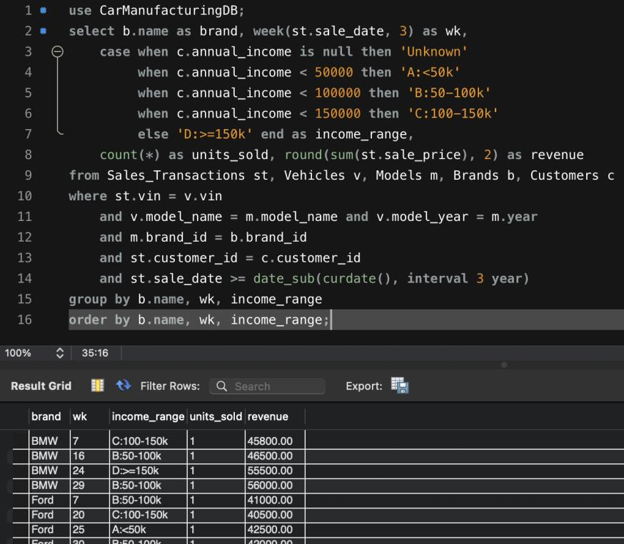 |

- Sales_Transactions에서 시작해 4번의 join 연산을 거쳐 고객 정보까지 접근한 후, WHERE 절로 최근 3년간의 매출만 조회하도록 설정했다.
- 소득 분위에 따른 분류는 `CASE` 절로 처리했다. (A, B, C, D 4단계)
- 브랜드의 트렌드를 알아보는 것이기 때문에 브랜드를 최우선 기준으로 정렬했다.
- year, month, week는 SELECT 절의 함수로 바꿀 수 있고, week는 파라미터로 3을 넣어(`week(st.sale_date, 3)`) 한 주의 시작을 월요일로 하는 ISO 기준을 적용했다.
- 6개 표 모두 정상 출력되었고, 최근 3년 범위 내의 판매만 집계된 것을 확인했다.

### Q2. Defective Part Tracking

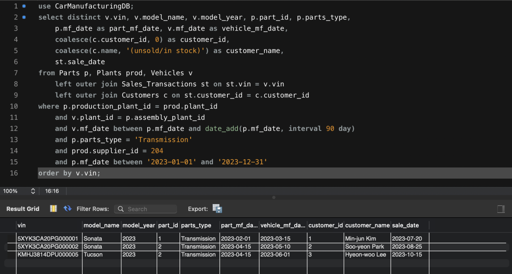
*입력: `('Transmission', 204, '2023-01-01' ~ '2023-12-31')`*

- Parts / Plants / Vehicles를 콤마 join하고 두 번의 join 연산을 더해 부품이 들어간 차량과 구매 고객 정보에 접근한 뒤, WHERE 절로 해당 부품과 관련 있는 차량·고객 정보만 조회하도록 설정했다.
- 차량이 판매되지 않았어도 결함 부품 추적이 가능해야 하므로 `LEFT OUTER JOIN`을 사용해 Sales_Transactions에 없는 정보도 결과에 포함했다.
- 추적 부품을 사용한 차량의 VIN, 제조일, 구매자 정보가 잘 출력됨을 확인했다.
- 현재는 해당 부품을 사용한 미판매 차량이 없어 출력되지 않았지만, LEFT JOIN 구조상 매칭 시 `(unsold/in stock)`으로 표시되도록 구현했다.

### Q3. Top Brands by Revenue

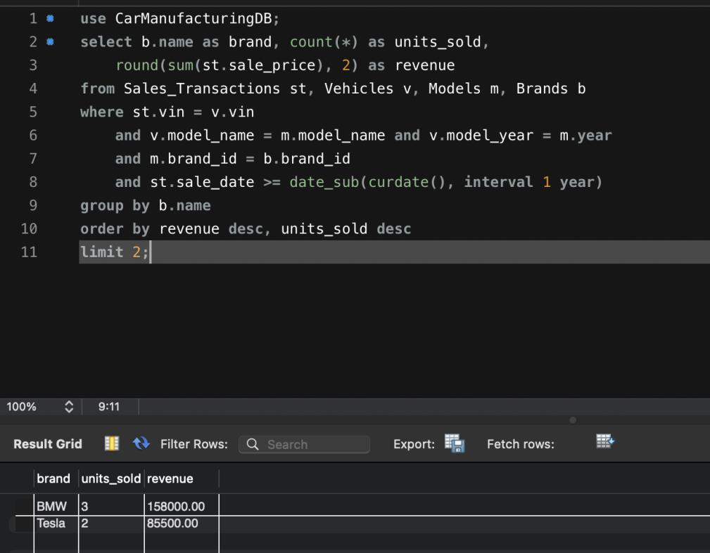

- 매출 합계와 판매량을 출력해야 하므로 `COUNT`와 `SUM`을 사용했다.
- WHERE 절로 날짜를 필터링한 뒤 `LIMIT 2`로 TOP 2 브랜드만 출력했다.
- 정확히 2개의 행이 출력되고, 매출 기준으로 정렬되었음을 확인했다.

### Q4. Top Brands by Unit Sales

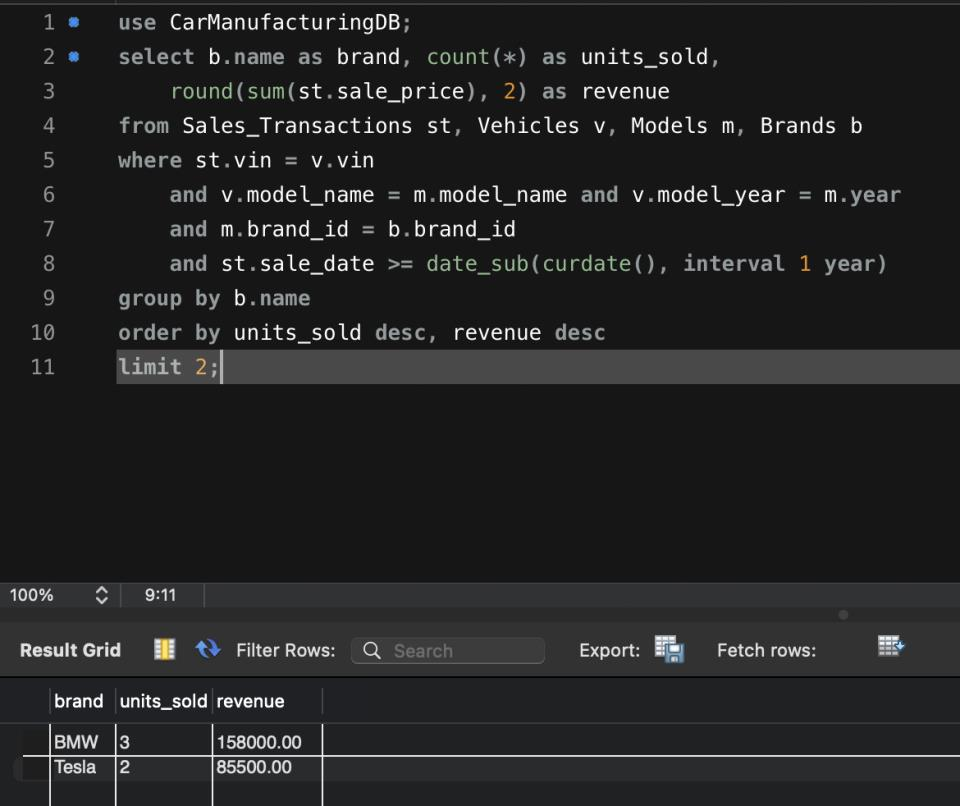

- Q3와 거의 동일하지만 정렬 순서를 `revenue → units_sold`에서 `units_sold → revenue`로 바꾸어 판매량 TOP 2를 출력했다.
- 정확히 2개의 행이 출력되고, 판매량 기준으로 정렬되었음을 확인했다.

### Q5. Seasonal Sales Patterns

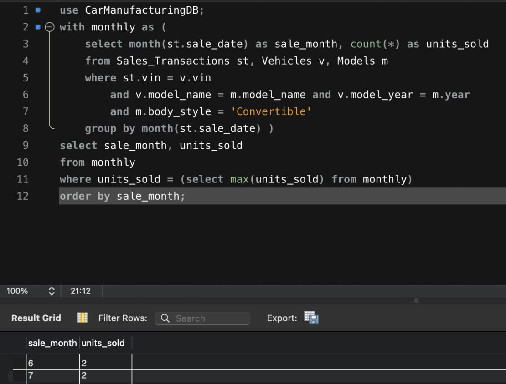
*convertible 스타일의 최다 판매 월 (6, 7월 동률)*

- `WITH` 절로 중간 연산 결과를 저장한 뒤 그 결과를 다시 연산에 사용하는 구조이다.
- 먼저 2번의 join으로 매출 정보와 Models의 `body_style`을 연결한다.
- WHERE 절로 원하는 body style을 필터링한 다음 `GROUP BY`로 월별로 묶고, 그중 가장 큰 값을 출력한다.
- Peak month만 출력되는 것을 확인했으며, 현재는 6, 7월이 동률이라 두 값 모두 출력되는 것까지 확인했다.

### Q6. Dealer Inventory Efficiency

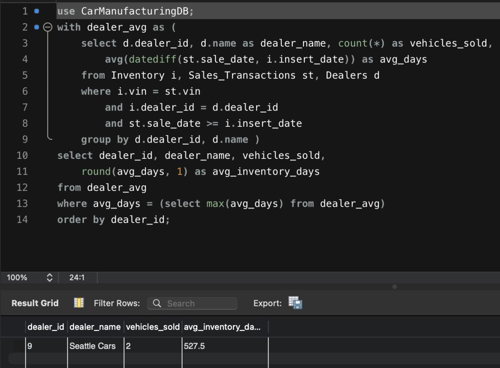
*평균 재고 보유 기간이 가장 긴 딜러*

- 판매량과 평균 보유일을 구하기 위해 `COUNT`와 `ROUND`를 사용했다. (Q5와 같이 `WITH` 절 사용)
- 데이터 오류를 제외하기 위해 `sale_date`가 `insert_date`보다 빠른 데이터는 WHERE 절에서 필터링했다.
- 이후 평균 보유일이 최대인 딜러를 출력하며, 의도대로 출력됨을 확인했다.

### Q7. Supplier Coverage

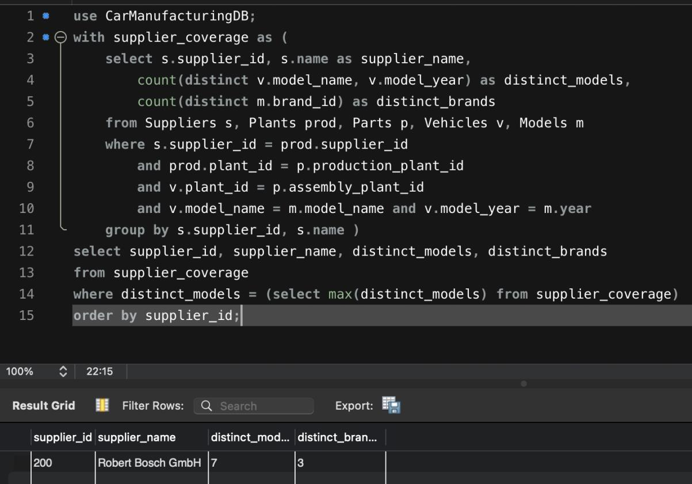
*가장 많은 모델에 부품을 공급한 supplier*

- 가장 많은 distinct model에 부품을 공급한 supplier를 찾아야 하므로, 5번의 join으로 Suppliers에서 시작해 Models까지 연결했다.
- `COUNT(DISTINCT ...)`로 모델 수와 브랜드 수를 세고, `MAX`와 일치하는 supplier를 출력한다.
- 가장 많은 모델에 부품을 공급한 supplier 한 곳만 출력되는 것을 확인했다.

---

## 5. Validation of business rule enforcement

DBMS의 비즈니스 규칙 작동을 테스트하기 위해, 애플리케이션을 거치지 않고 직접 SQL로 위반을 시도하는 검증을 수행했다.

### 1) 중복 PK 값 (PRIMARY KEY)
```sql
insert into Brands values (1, 'Duplicate Brand');
```
Hyundai와 동일한 PK를 가진 행 추가 시도
→ `ERROR 1062: Duplicate entry '1' for key 'brands.PRIMARY'`

### 2) 자식 행이 있는 부모 삭제 거부 (FOREIGN KEY)
```sql
delete from Customers where customer_id = 1;
```
외래키로 참조되고 있는 값 삭제 시도
→ `ERROR 1451: Cannot delete or update a parent row: a foreign key constraint fails`

### 3) 부모 삭제 시 자식 자동 정리 (ON DELETE CASCADE)
```sql
insert into Customers (customer_id, name) values (9999, 'Cascade Test User');
insert into Customer_Phones values (9999, '010-9999-0001');
insert into Customer_Phones values (9999, '010-9999-0002');
delete from Customers where customer_id = 9999;
select * from Customer_Phones where customer_id = 9999;
```
임시 데이터 생성 후 Customers 삭제 시 Customer_Phones가 삭제되는지 확인

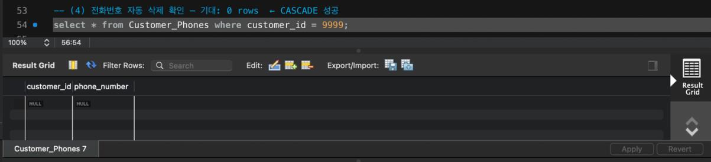

→ 0 rows 반환 (종속된 Phones가 자동으로 삭제됨)

### 4) 중복값 거부 (UNIQUE)
```sql
insert into Brands values (999, 'Toyota');
```
UNIQUE 제약이 있는 브랜드명에 이미 있는 이름 삽입 시도
→ `ERROR 1062: Duplicate entry 'Toyota' for key 'brands.name'`

### 5) 필수 컬럼 (NOT NULL)
```sql
insert into Vehicles (vin, model_name, model_year, plant_id, mf_date)
values ('TESTNULL01VINAAAA', 'Camry', 2023, 3, NULL);
```
필수 컬럼에 NULL 입력 시도
→ `ERROR 1048: Column 'mf_date' cannot be null`

### 6) 정의하지 않은 enum 값 (CHECK)
```sql
insert into Vehicles (vin, model_name, model_year, plant_id, mf_date, current_status)
values ('TESTCHK01VINAAAAA', 'Camry', 2023, 3, '2024-01-01', 'Unknown');
```
CHECK 제약에 정의된 값 이외의 값으로 삽입 시도
→ `ERROR 3819: Check constraint 'vehicles_chk_1' is violated`

### 7) 기본값 (DEFAULT)
```sql
insert into Vehicles (vin, model_name, model_year, plant_id, mf_date)
values ('TESTDEF01VINAAAAA', 'Camry', 2023, 3, '2024-01-15');
select vin, current_status from Vehicles where vin = 'TESTDEF01VINAAAAA';
```
`current_status`를 명시하지 않았을 때 저장되는 값 확인

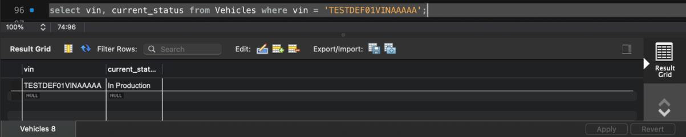

→ `In Production`(기본값)이 자동으로 저장됨

### 8) 차량 생명주기 자동 갱신 (TRIGGER)
```sql
insert into Inventory values ('TESTTRG01VINAAAAA', 1, '2024-02-01');
select vin, current_status from Vehicles where vin = 'TESTTRG01VINAAAAA';

insert into Sales_Transactions
    (transaction_id, vin, dealer_id, customer_id, sale_date, payment_method, sale_price)
values (9990, 'TESTTRG01VINAAAAA', 1, 1, '2024-03-15', 'Cash', 30000);
select vin, current_status from Vehicles where vin = 'TESTTRG01VINAAAAA';
```
입고, 판매 시 UPDATE 없이 `current_status`가 자동으로 갱신되는지 확인

| 입고 후 (`trg_inventory_insert`) | 판매 후 (`trg_sale_insert`) |
|---|---|
| 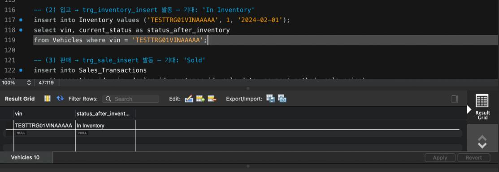 | 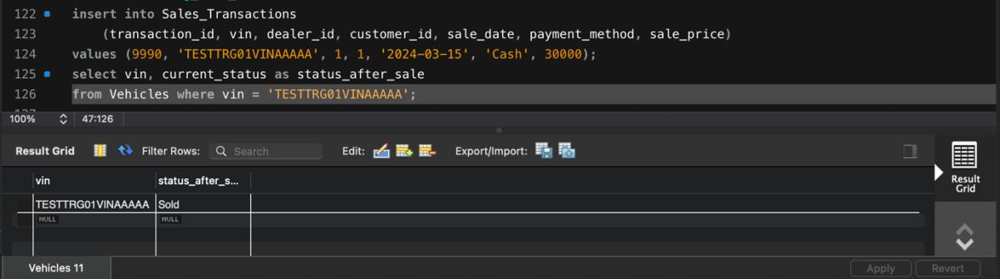 |

→ `In Production` → `In Inventory` → `Sold`로 자동 변경됨

### 실행 로그
실험 증빙을 위한 실제 error 로그

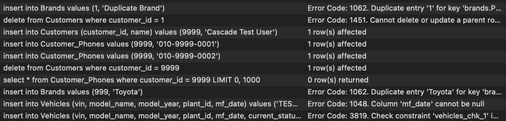

---

## 6. C++ Application 설명

### 1) 데이터베이스 연결
- MySQL C API와 ODBC 두 가지 연결 방식을 모두 구현하여, 어느 한쪽이 환경상의 이유로 작동하지 않더라도 다른 한쪽으로 실행할 수 있도록 했다. (ODBC 코드를 `#ifdef HAVE_ODBC`로 감싸 C API만으로도 빌드 가능)
- MySQL C API는 `mysql_init`으로 빈 객체를 만든 뒤 `mysql_real_connect`로 연결하는 짧은 흐름이지만, ODBC는 환경 핸들(ENV) → 연결 핸들(DBC) → 명령 핸들(STMT)의 위계 구조를 따라야 한다.
- 따라서 쿼리를 처리하기 위해 백엔드별로 코드를 다르게 작성해야 하는 문제가 있는데, 이는 `database.h`에 두 백엔드를 감싸는 공통 facade를 두어 해결했다.
- 무결성 보장을 위해 두 백엔드를 동시에 활성화할 수 없도록 `g_connected` 플래그를 두었다. (연결된 상태에서 다시 연결 시도 시 `Already connected` 출력)
- 두 백엔드 모두 `prepare → bind_param → execute → result_metadata → bind_result → fetch` 6단계 파이프라인으로 실행된다. 사용자가 입력한 값은 SQL 문자열에 직접 결합되지 않고 항상 `?` 자리 표시자에 바인딩되어 별도 채널로 전달되므로, 어떤 입력이 들어와도 SQL 문장의 구조가 변경되지 않는다.

### 2) Query 구현
기본적인 쿼리 동작 방식은 [4. 쿼리 실행](#4-쿼리-실행)에서 설명한 것과 동일하며, 여기서는 애플리케이션 단계에서 구현한 항목만 서술한다.

- **Q1**: year, month, week별로 나누고 gender, income range별로 Sales Trends를 분석하므로 총 6개의 테이블이 나온다. 6개의 테이블은 JOIN 연산 일부를 공유하고, income range를 포함한 테이블은 소득 구간 분류를 동일하게 수행하므로 해당 부분을 static 문자열로 정의하여 재사용했다.
- **Q2**: 추적하고자 하는 부품의 종류, 공급자 ID, 시작일, 종료일을 입력받아 prepared statement의 `?` 자리에 바인딩한다.
- **Q5**: `body_style` 한 가지를 입력받아 `?` 자리에 바인딩한다.

### 3) 오류 처리
오류 처리는 4단계 패턴을 가진다.

1. 오류 캡처 (`mysql_error`, `mysql_stmt_error`, `SQLGetDiagRec`)
2. stderr에 실패 사유 출력
3. 할당된 모든 핸들과 메모리를 명시적으로 해제
4. 호출자에게 `false` 반환

이 과정을 통해 어느 단계에서 실패하더라도 핸들 누수가 발생하지 않으며, DB가 반환한 NULL 값도 안전하게 처리된다.

- 예) Q2의 `supplier_id` 입력으로 `1; DROP TABLE Customers; --`와 같은 SQL injection을 시도하더라도 prepared statement가 이를 데이터로만 취급하여 테이블이 유지된다.
- 메뉴 입력란에 숫자가 아닌 값을 넣으면 `std::stoi`의 예외로 잡혀 `Invalid choice`가 출력된다.

### 4) UI

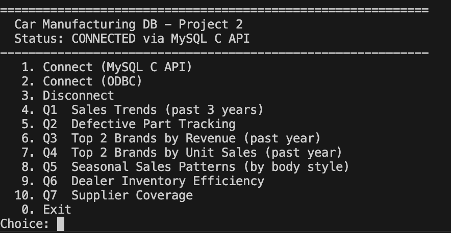

- 0~10 숫자 입력으로 각 항목에 접근할 수 있으며, 1, 2번으로 DB에 연결하고 3번으로 기존 연결을 끊을 수 있다.
- DB에 연결한 후 4~10번으로 Q1~Q7 쿼리의 결과를 출력할 수 있다.
- 0번은 종료 버튼 역할을 한다.
- 추가 입력이 필요한 쿼리를 선택하면 입력을 받은 다음 결과를 출력하고, 결과는 `printTable()` 함수로 column 폭을 자동 조정한 실제 테이블 형태로 출력된다.

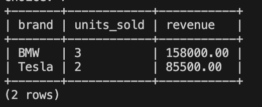
